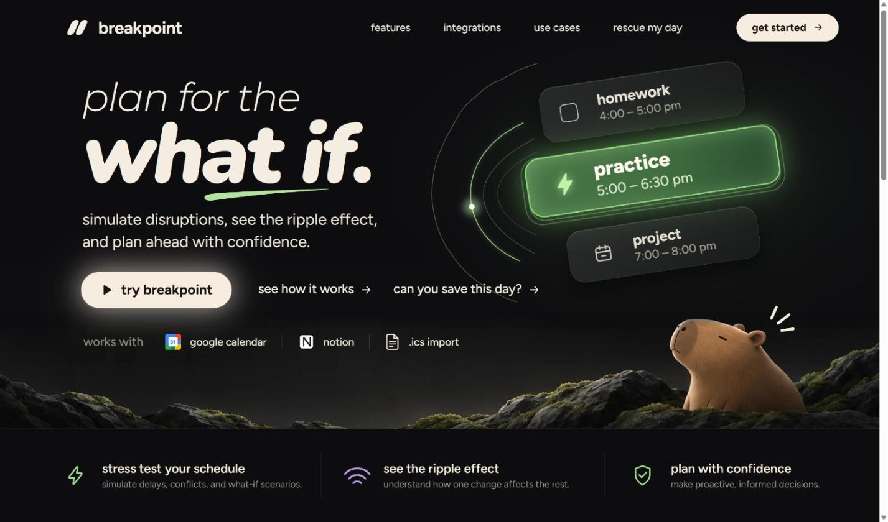
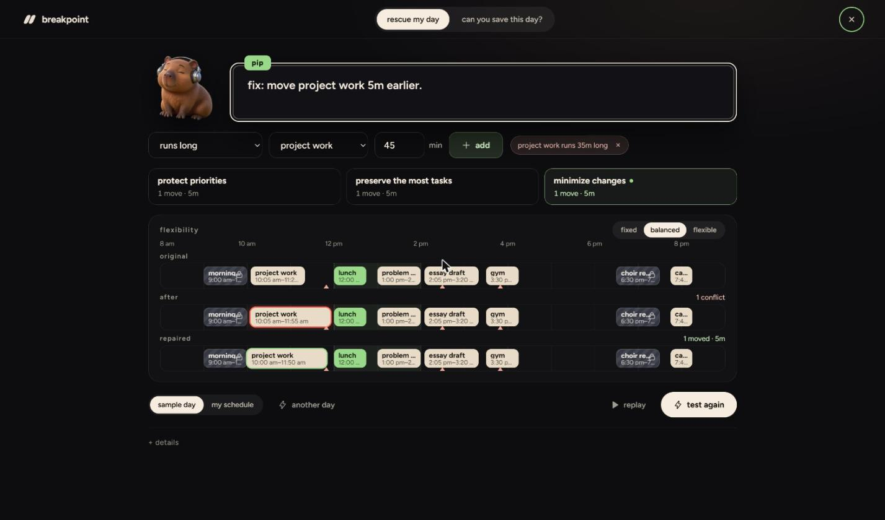

# breakpoint

plan for the what if.

you make a plan. then something runs ten minutes long and the whole evening slides. breakpoint is for that moment, and for the one before it: it tells you how much your day can take before something important breaks, and when it does break, it finds the smallest change that fixes it.

try it: https://breakpoint-41x.pages.dev (no account needed)

## what it does

**it shows you where your day breaks.** give any task extra minutes and breakpoint follows the ripple through the rest of the day. if a project has 25 minutes of buffer and runs 45 minutes long, it doesn't say "you're in trouble". it says you are 20 minutes short and which deadline that costs you.

**it fixes the day without breaking your promises.** locked things (class, a meeting) never move, deadlines are never missed, and your lunch stays inside its window. if there is no valid schedule at all, it says so and shows you why, instead of making something up.

**three ways forward.** the same problem can be fixed more than one way, so you get to pick:

- protect your priorities
- keep as many tasks as possible
- change as little as possible

then **test again** takes the repaired day and breaks it a second time, to see if the fix actually holds.

**pip explains it in a few words.** pip is a capybara who talks in a small box at the top, one short line at a time. every number pip says comes straight from the schedule math, so nothing is invented.

**can you save this day?** a small game. you get a deliberately fragile day, you fix it by hand, and then breakpoint shows how it would have done it and scores you against the smallest valid fix.

## bring your own schedule

you can import from google calendar, apple calendar, notion or an .ics file. everything is read-only: breakpoint never writes to your calendar, and a calendar link is used once and not saved. guest data is deleted after 24 hours.

## how it works, in short

the scheduling is not an ai guessing. it is plain, deterministic code: integer minutes, an exact solver for "the smallest change", and no randomness except where it is seeded. the same day always gives the same answer, and a test suite checks the solver against brute force. the site is vite and vanilla js, the api runs on cloudflare workers with d1.

the longer notes are in [`server/docs/RESCUE.md`](server/docs/RESCUE.md) if you want to see what "smallest" means exactly.

## honest limits

- google sign-in is switched off on purpose, because google wants to verify any app that reads calendars. google calendar works through its private link instead.
- apple calendar works through its public link or an exported file. apple has no calendar sign-in, and i didn't want to ask anyone for an apple password.
- there is no separate dashboard: finishing setup takes you straight into rescue my day on your schedule.

## ai use disclosure

i used ai (claude, from anthropic) as a coding assistant while building breakpoint.

- **ui:** i used ai to improve the ui of the website and to polish it: layout, motion, the minimal rescue screen and the wording on it.
- **bugs:** i used ai to find and fix bugs, including a full test pass of the live site (phone layout, keyboard handling, import errors).
- **code:** ai also helped write and test parts of the scheduling engine, the api and the connectors. i chose what to build and reviewed what it produced.
- **launch video:** the video was built in code with ai help, and its narration is an ai-generated voice.

made by sripad for a hackathon.
